# Movie Watchlist App - Complete Diagram Set

## 1) Use Case Diagram

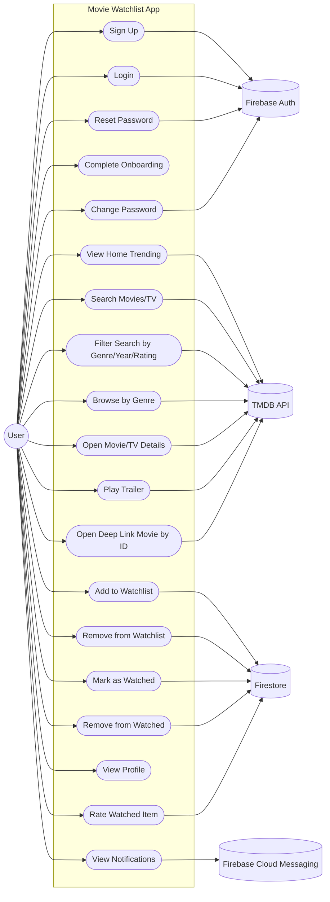

## 2) Class Diagram

```mermaid
classDiagram
  class AuthRepository {
    <<interface>>
    +Stream~User?~ authStateChanges
    +signInWithEmailAndPassword(email, password) User?
    +signUpWithEmailAndPassword(email, password) User?
    +signOut() void
  }

  class FirebaseAuthRepository
  AuthRepository <|.. FirebaseAuthRepository

  class TmdbRemoteDataSource {
    +searchMovies(query, filters, page) MoviePage
    +getTrending(page) MoviePage
    +getGenres() List~Genre~
  }

  class MovieRepository {
    <<interface>>
    +searchMovies(query, filters, page) Result~MoviePage~
    +getTrending(page) Result~MoviePage~
    +getGenres() Result~List~Genre~~
  }

  class MovieRepositoryImpl
  MovieRepository <|.. MovieRepositoryImpl
  MovieRepositoryImpl --> TmdbRemoteDataSource

  class GetTrendingMoviesUseCase {
    +call(page) Result~MoviePage~
  }
  class SearchMoviesUseCase {
    +call(query, filters, page) Result~MoviePage~
  }
  class GetMovieGenresUseCase {
    +call() Result~List~Genre~~
  }

  GetTrendingMoviesUseCase --> MovieRepository
  SearchMoviesUseCase --> MovieRepository
  GetMovieGenresUseCase --> MovieRepository

  class WatchlistRepository {
    <<interface>>
    +getWatchlist() Stream~List~WatchlistItem~~
    +add(item) void
    +remove(item) void
  }
  class WatchlistRepositoryImpl
  WatchlistRepository <|.. WatchlistRepositoryImpl

  class FirestoreWatchlistDataSource
  WatchlistRepositoryImpl --> FirestoreWatchlistDataSource

  class WatchlistService {
    +getWatchlistStream() Stream~List~WatchlistItem~~
    +addItem(item) void
    +removeItem(item) void
    +isInWatchlist(item) bool
  }

  class WatchedService {
    +getWatchedStream() Stream~List~WatchlistItem~~
    +addItem(item) void
    +removeItem(item) void
    +setRating(item, rating) void
    +getRating(item) int?
  }

  class NotificationService {
    +initialise(navigatorKey) void
    +addNotification(title, message) void
    +markAsRead(id) void
  }

  class Movie {
    +int id
    +String title
    +String overview
    +double voteAverage
    +List~int~ genreIds
  }
  class TvShow {
    +int id
    +String name
    +String overview
    +double voteAverage
    +List~int~ genreIds
  }
  class Genre {
    +int id
    +String name
  }
  class MovieFilters {
    +int? genreId
    +int? year
    +double? minimumRating
  }
  class MoviePage {
    +List~Movie~ movies
    +int page
    +int totalPages
  }
  class WatchlistItem {
    +int id
    +String type
    +Map data
    +String docId
  }
```

## 3) Sequence Diagrams (10)

### 3.1 Login Flow
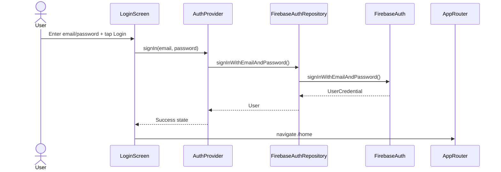

### 3.2 Signup Flow
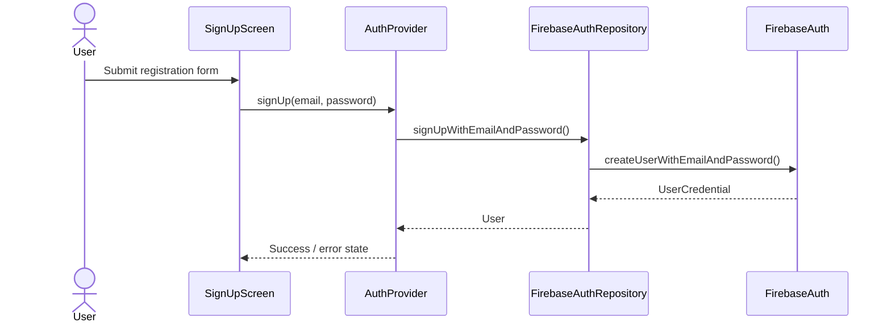

### 3.3 Load Home Trending
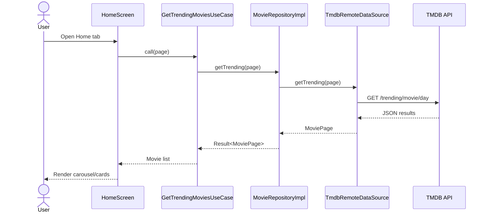

### 3.4 Search with Filters
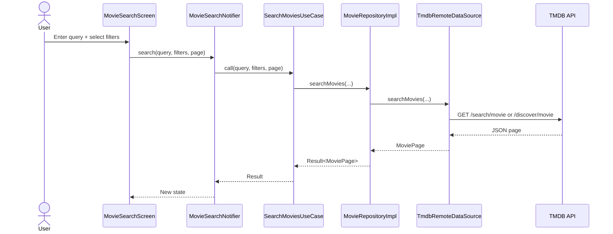

### 3.5 Open Details from Search/Home
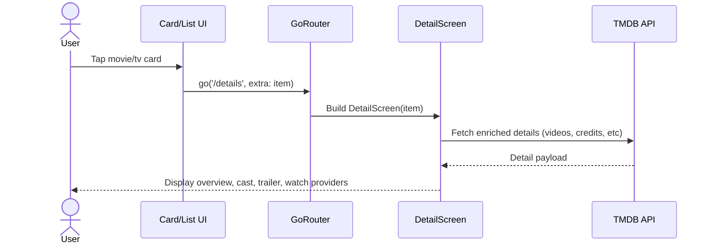

### 3.6 Add to Watchlist
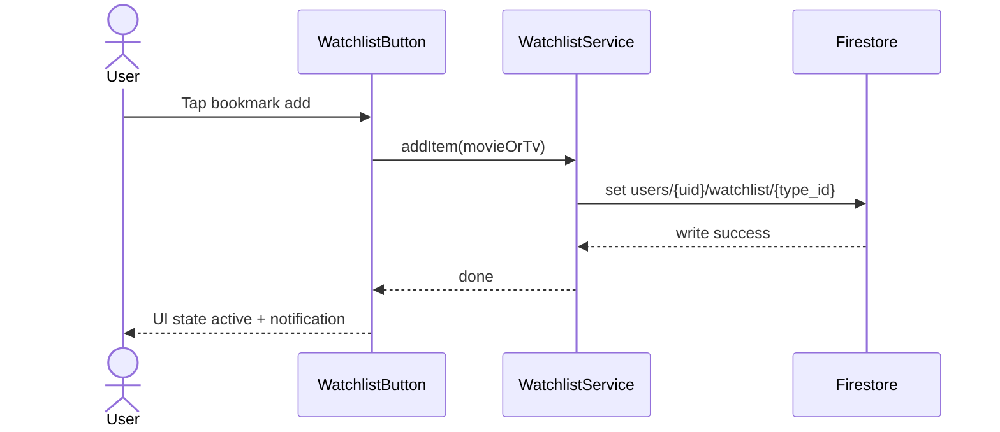

### 3.7 Remove from Watchlist
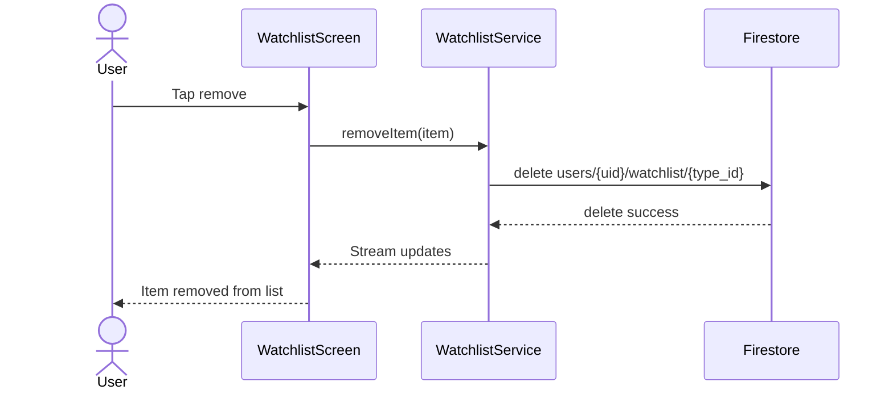

### 3.8 Mark Item as Watched + Rate
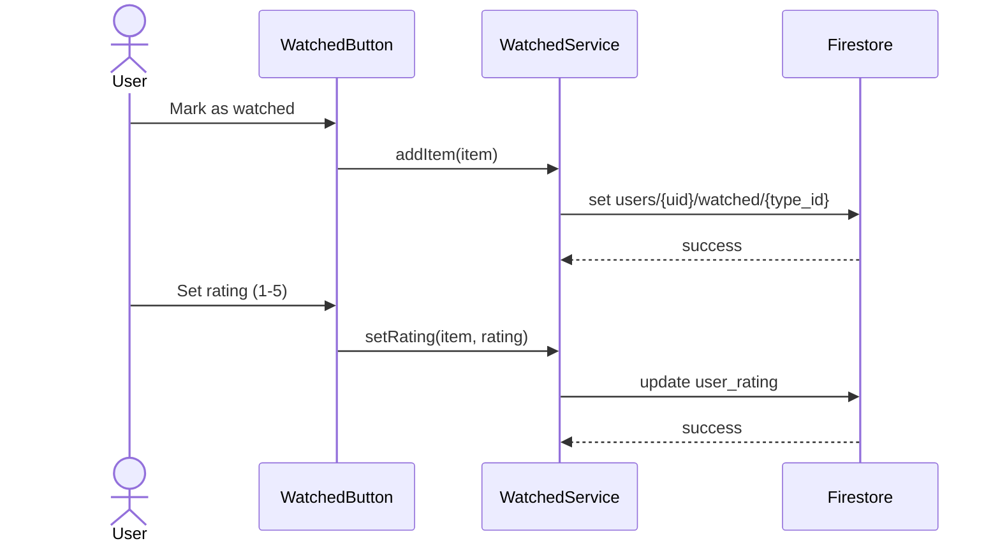

### 3.9 Notification Arrival and Open
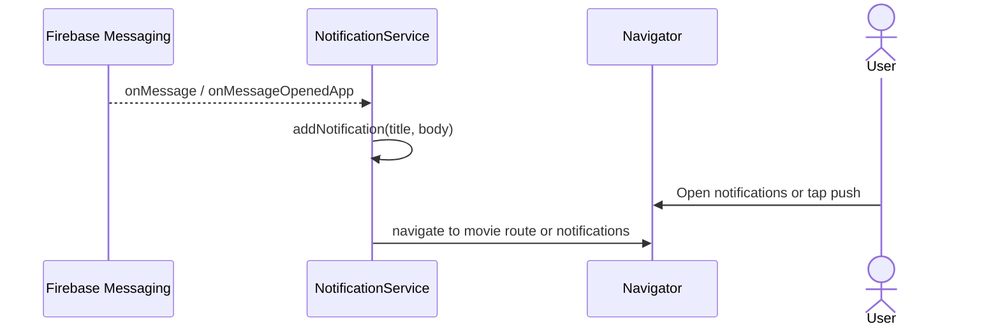

### 3.10 Deep Link Movie Route
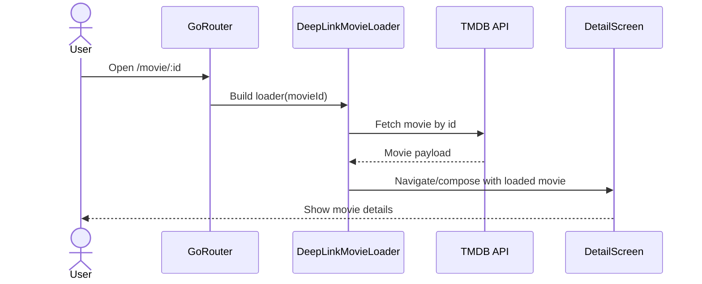

## 4) Activity Diagram (End-to-End User Journey)

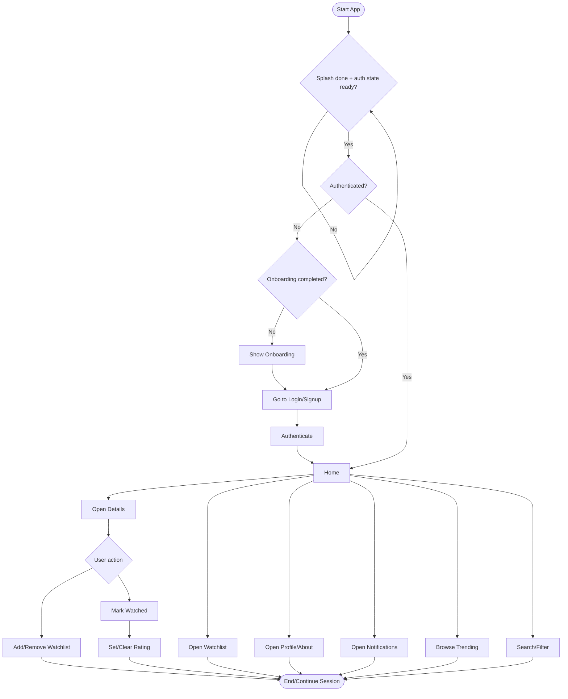

## 5) Data Flow Diagram (Logical DFD - Level 1)

```mermaid
flowchart LR
  U((User))
  P1[Auth Process]
  P2[Discovery/Search Process]
  P3[Watchlist Process]
  P4[Watched & Rating Process]
  P5[Notification Process]

  D1[(Firebase Auth)]
  D2[(TMDB API)]
  D3[(Firestore users/{uid}/watchlist)]
  D4[(Firestore users/{uid}/watched)]
  D5[(In-memory Notifications)]
  D6[(FCM)]

  U -->|Credentials| P1
  P1 -->|Login/Signup/Reset| D1
  D1 -->|Auth State| P1
  P1 -->|Session| U

  U -->|Query/filters/navigation| P2
  P2 -->|Read movies/tv/genres| D2
  D2 -->|Results/details| P2
  P2 -->|Rendered content| U

  U -->|Add/remove watchlist| P3
  P3 -->|Write/read stream| D3
  D3 -->|Watchlist items| P3
  P3 -->|List + badge| U

  U -->|Mark watched/rate| P4
  P4 -->|Write/read stream| D4
  D4 -->|Watched items + ratings| P4
  P4 -->|Watched UI| U

  D6 -->|Push message| P5
  U -->|Open/mark/remove notifications| P5
  P5 -->|Store/read| D5
  P5 -->|Notification list + deep link nav| U
```

## 6) ER Diagram (Firestore-Centric Data Model)

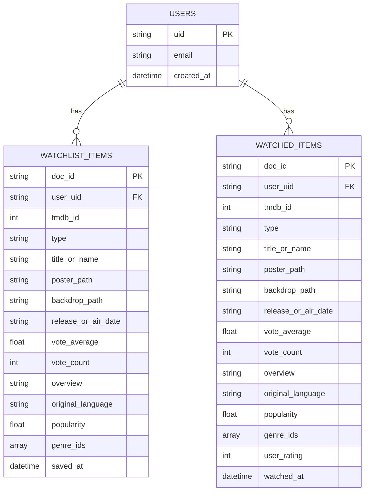

## 7) Notes on Coverage

- Diagram set is aligned to current Flutter architecture and features present in `lib/`.
- Sequence diagrams intentionally cover the major interaction paths end to end.
- If you want, the next step can be generating a PlantUML version and exporting PNG/SVG files for reports.

## 8) Textual Version of Each Diagram

### 8.1 Textual Use Case Model

Actor:
- User

External systems:
- Firebase Auth
- TMDB API
- Firestore
- Firebase Cloud Messaging (FCM)

Use cases:
1. Sign Up: user creates account via Firebase Auth.
2. Login: user signs in via Firebase Auth.
3. Reset Password: user requests reset using Firebase Auth flow.
4. Complete Onboarding: first-time user completes onboarding screens.
5. View Home Trending: app fetches trending movies from TMDB.
6. Search Movies/TV: user searches content using TMDB endpoints.
7. Filter Search by Genre/Year/Rating: user applies filters; app uses TMDB discover/search query params.
8. Browse by Genre: user opens a genre and sees matching content.
9. Open Movie/TV Details: app loads detailed metadata from TMDB.
10. Play Trailer: app uses trailer data loaded from TMDB detail responses.
11. Add to Watchlist: app stores selected item in Firestore under user watchlist.
12. Remove from Watchlist: app deletes item from Firestore watchlist.
13. Mark as Watched: app stores item in Firestore watched collection.
14. Remove from Watched: app deletes watched item from Firestore.
15. Rate Watched Item: app writes `user_rating` to watched document.
16. View Notifications: user views local/push notification entries.
17. View Profile: user opens profile tab/screen.
18. Change Password: user changes password through auth flow.
19. Open Deep Link Movie by ID: route `/movie/:id` resolves item and opens details.

### 8.2 Textual Class Model

Authentication layer:
- `AuthRepository` defines auth contract: auth state stream, sign in, sign up, sign out.
- `FirebaseAuthRepository` implements that contract using Firebase Authentication SDK.

Movies/discovery layer:
- `TmdbRemoteDataSource` handles remote HTTP calls to TMDB (`searchMovies`, `getTrending`, `getGenres`).
- `MovieRepository` defines domain-facing repository interface.
- `MovieRepositoryImpl` delegates to `TmdbRemoteDataSource` and maps errors/results.
- Use cases:
  - `GetTrendingMoviesUseCase`
  - `SearchMoviesUseCase`
  - `GetMovieGenresUseCase`
  These depend on `MovieRepository`.

Watchlist layer:
- `WatchlistRepository` defines domain contract for watchlist stream and mutations.
- `WatchlistRepositoryImpl` implements contract using `FirestoreWatchlistDataSource`.
- `WatchlistService` provides practical watchlist operations used by UI/providers.

Watched layer:
- `WatchedService` mirrors watchlist behavior but persists in watched collection and manages ratings.

Notifications layer:
- `NotificationService` initializes FCM listeners, stores in-memory notifications, and handles navigation on push taps.

Core entities/value objects:
- `Movie`, `TvShow`, `Genre`, `MovieFilters`, `MoviePage`, `WatchlistItem`.

### 8.3 Textual Sequence Model (10 Flows)

1. Login Flow:
- User submits credentials on `LoginScreen`.
- UI asks auth provider to sign in.
- Provider calls `FirebaseAuthRepository`.
- Repository calls Firebase Auth SDK.
- On success, user object returns and router redirects to `/home`.

2. Signup Flow:
- User submits registration on `SignUpScreen`.
- Provider calls `signUpWithEmailAndPassword`.
- Firebase creates account and returns user.
- UI receives success state (or error state).

3. Load Home Trending:
- User opens Home tab.
- `HomeScreen` triggers `GetTrendingMoviesUseCase`.
- Use case calls repository, repository calls TMDB data source.
- TMDB returns JSON list; app maps to `MoviePage`.
- UI renders cards/carousel.

4. Search with Filters:
- User enters query and filters.
- Screen/notifier triggers `SearchMoviesUseCase`.
- Repository/data source call TMDB search or discover endpoint.
- Results map to domain model and update screen state.

5. Open Details from Search/Home:
- User taps item card.
- Router navigates to `/details` with selected item.
- Details screen fetches enriched details from TMDB.
- UI renders overview, cast, trailer, and watch-provider info.

6. Add to Watchlist:
- User taps watchlist button.
- `WatchlistService.addItem` creates `type_id` doc id.
- Firestore writes `users/{uid}/watchlist/{type_id}`.
- UI toggles state and shows feedback.

7. Remove from Watchlist:
- User removes item from watchlist screen.
- Service deletes Firestore document.
- Stream refreshes and list updates automatically.

8. Mark as Watched + Rate:
- User marks item watched via `WatchedService.addItem`.
- Firestore saves item in `users/{uid}/watched/{type_id}`.
- User sets rating; service updates `user_rating`.

9. Notification Arrival and Open:
- FCM emits message to `NotificationService`.
- Service stores notification in in-memory list.
- On tap/open, app navigates to target movie route or notifications screen.

10. Deep Link Movie Route:
- User opens `/movie/:id`.
- Router builds `DeepLinkMovieLoader`.
- Loader fetches item from TMDB by id.
- App opens detail view with loaded data.

### 8.4 Textual Activity Model (End-to-End Journey)

1. App starts and shows splash.
2. App waits until splash timer and auth state are both ready.
3. Decision: authenticated or not.
4. If not authenticated, decision: onboarding complete or not.
5. If onboarding not complete, show onboarding then move to login/signup.
6. User authenticates and enters Home.
7. From Home, user can browse trending, search/filter, open details, open watchlist, open profile/about, and open notifications.
8. In details, user can add/remove watchlist and mark/rate watched.
9. Session can continue with repeated navigation/actions or end.

### 8.5 Textual Data Flow Model (DFD Level 1)

External entity:
- User

Processes:
- `P1` Auth Process
- `P2` Discovery/Search Process
- `P3` Watchlist Process
- `P4` Watched & Rating Process
- `P5` Notification Process

Data stores/systems:
- `D1` Firebase Auth
- `D2` TMDB API
- `D3` Firestore watchlist collection
- `D4` Firestore watched collection
- `D5` In-memory notifications store
- `D6` FCM

Main flows:
1. User credentials enter `P1`; `P1` exchanges auth operations with `D1`; session state returns to user.
2. User queries/filters enter `P2`; `P2` reads from `D2`; content returns to user.
3. User watchlist actions enter `P3`; `P3` writes/reads `D3`; updated list/badge returns to user.
4. User watched/rating actions enter `P4`; `P4` writes/reads `D4`; updated watched list returns to user.
5. Push messages arrive from `D6` into `P5`; user notification actions also enter `P5`; `P5` reads/writes `D5`; notification UI/deeplink navigation returns to user.

### 8.6 Textual ER Model

Entity: `USERS`
- Primary key: `uid`
- Attributes: `email`, `created_at`

Entity: `WATCHLIST_ITEMS`
- Primary key: `doc_id` (format typically `movie_<id>` or `tv_<id>`)
- Foreign key: `user_uid` references `USERS.uid`
- Main attributes: content id/type/title/media metadata, genre ids, saved timestamp

Entity: `WATCHED_ITEMS`
- Primary key: `doc_id`
- Foreign key: `user_uid` references `USERS.uid`
- Main attributes: same base metadata as watchlist plus `user_rating` and watched timestamp

Relationships:
1. One user to many watchlist items (`USERS 1:N WATCHLIST_ITEMS`).
2. One user to many watched items (`USERS 1:N WATCHED_ITEMS`).

Business rules:
1. A watchlist item belongs to exactly one user.
2. A watched item belongs to exactly one user.
3. `user_rating` is optional until user rates the watched item.
